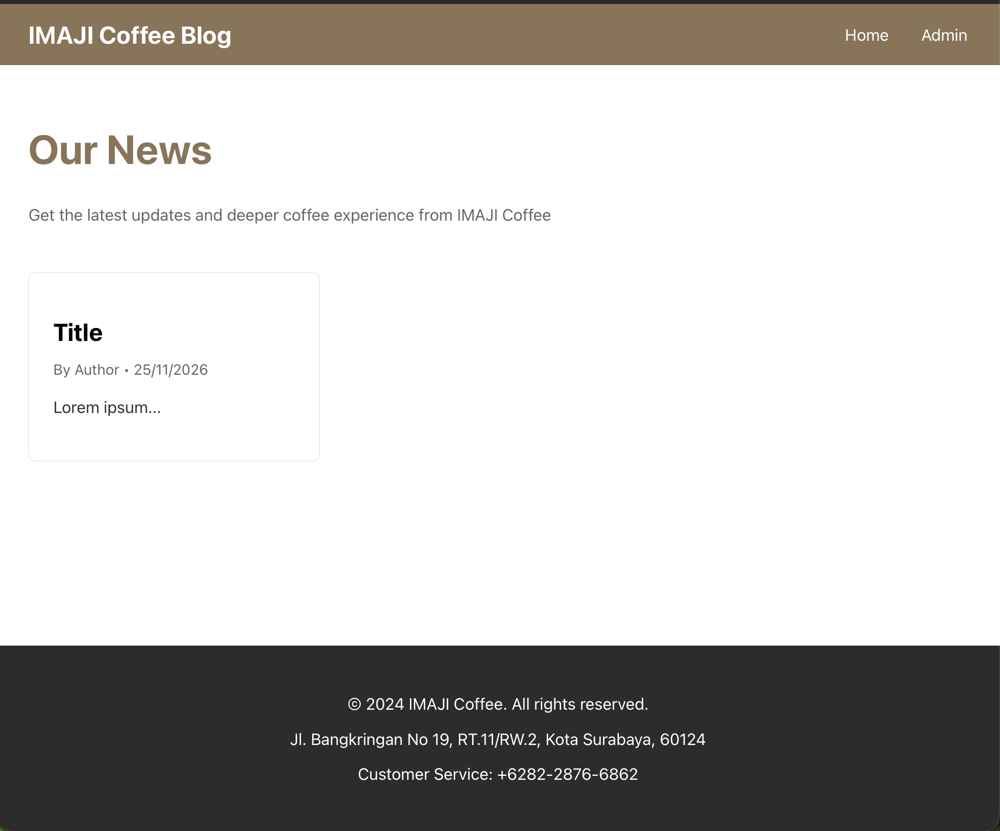
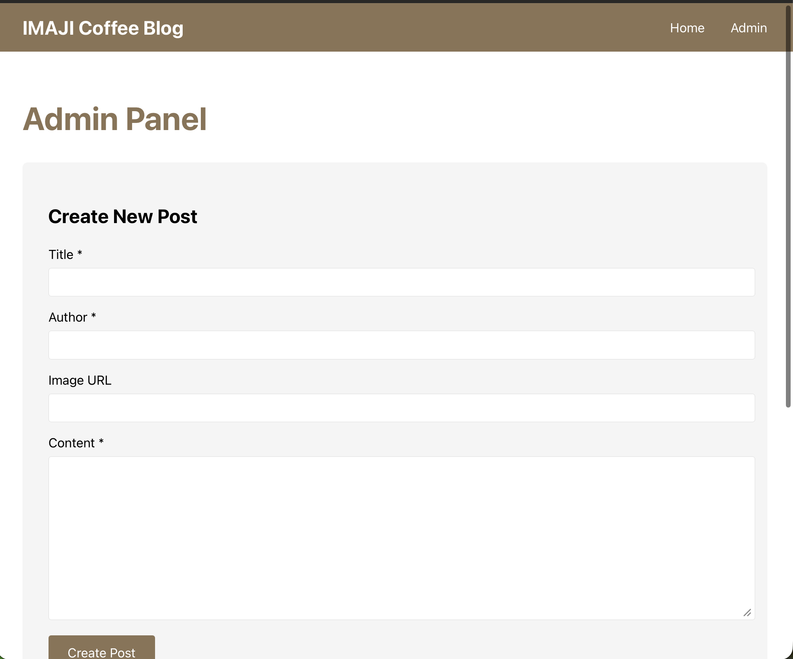
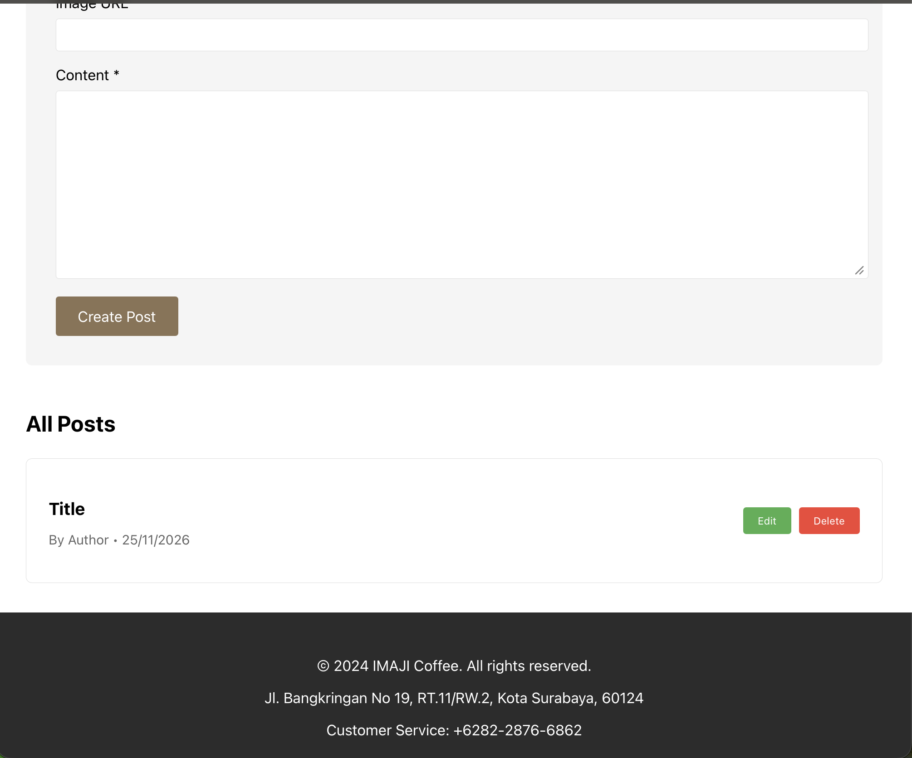
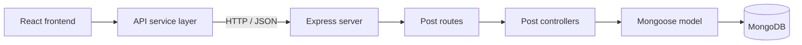

# IMAJI Coffee Blog

A full-stack blogging application built with React,
Express.js and MongoDB, featuring a coffee-themed editorial
interface and an article management dashboard.

## Overview

IMAJI Coffee Blog explores the implementation of a complete
content management workflow, from browsing and reading articles
to creating, updating and deleting content through a REST API.

The application separates the presentation layer, server-side
logic and database into independently maintained components.

## Application screenshots

Screenshots of the running React application connected to
the Express API and local MongoDB database.

### Blog homepage



### Post creation



### Post management



## Features

### Reader Interface

- Blog article listing
- Individual article detail pages
- Dynamic client-side routing
- Reusable navigation and footer components
- Integration with a REST API

### Content Management

- Dedicated administration interface
- Article creation
- Article editing
- Article deletion
- Persistent MongoDB storage

The administration interface is currently a development
prototype without authentication or authorization.

## Technology Stack

| Technology | Purpose |
|---|---|
| React 19 | Component-based frontend |
| React Router 7 | Client-side navigation |
| JavaScript | Application logic |
| CSS | Interface styling |
| Node.js | Backend runtime |
| Express 5 | REST API |
| MongoDB | Document database |
| Mongoose 9 | Database modelling |
| dotenv | Environment configuration |
| Nodemon | Backend development |

## System Architecture



The frontend communicates with the backend using the Fetch API.
Express routes delegate article operations to controllers,
while Mongoose provides the database abstraction.

## Frontend Architecture

| Component | Responsibility |
|---|---|
| App.js | Application routing |
| BlogList.jsx | Article listing |
| BlogDetail.jsx | Individual article view |
| AdminPanel.jsx | Content management |
| Navbar.jsx | Navigation |
| Footer.jsx | Shared footer |
| services/api.js | HTTP request abstraction |

### Application Routes

| Route | Description |
|---|---|
| / | Blog homepage |
| /post/:id | Individual article |
| /admin | Content management interface |

## REST API

Base URL: `http://localhost:5001/api`

| Method | Endpoint | Description |
|---|---|---|
| GET | /posts | Retrieve articles |
| GET | /posts/:id | Retrieve a single article |
| POST | /posts | Create an article |
| PUT | /posts/:id | Update an article |
| DELETE | /posts/:id | Delete an article |

### Example Article Payload

```json
{
  "title": "The Art of Brewing Coffee",
  "content": "An introduction to coffee brewing techniques.",
  "author": "Editorial Team",
  "image": ""
}
```

## Database Model

Articles are represented using a Mongoose schema.

| Field | Type | Required |
|---|---|---|
| title | String | Yes |
| content | String | Yes |
| author | String | Yes |
| date | Date | Defaults to current date |
| image | String | No |

MongoDB automatically assigns a unique identifier to each article.

## Project Structure

```text
imaji-coffee-blog/
├── backend/
│   ├── config/
│   │   └── db.js
│   ├── controllers/
│   │   └── postController.js
│   ├── models/
│   │   └── Post.js
│   ├── routes/
│   │   └── postRoutes.js
│   ├── server.js
│   ├── .env.example
│   └── package.json
├── frontend/
│   ├── public/
│   ├── src/
│   │   ├── components/
│   │   ├── pages/
│   │   ├── services/
│   │   ├── AdminPanel.jsx
│   │   └── App.js
│   └── package.json
├── .gitignore
└── README.md
```

## Getting Started

### Prerequisites

- Node.js and npm
- A running local or hosted MongoDB instance
- Git

### Clone the Repository

```bash
git clone https://github.com/mefrinthearea/imaji-coffee-blog.git
cd imaji-coffee-blog
```

### Backend Setup

```bash
cd backend
npm ci
cp .env.example .env
```

Configure the MongoDB connection string in `.env`.

```env
PORT=5001
MONGO_URI=mongodb://127.0.0.1:27017/imaji_blog
```

Start the backend:

```bash
npm start
```

For development with automatic restarts:

```bash
npm run dev
```

### Frontend Setup

Open another terminal from the repository root:

```bash
cd frontend
npm ci
npm start
```

The frontend development server normally runs at:

http://localhost:3000

The backend runs at:

http://localhost:5001

## Production Build

```bash
cd frontend
npm run build
```

The compiled frontend is generated in `frontend/build/`.

## Verification

The frontend production build was successfully completed
on November 25, 2026.

The build reported an outdated Browserslist database and
a React useEffect dependency warning in BlogDetail.jsx.

Backend database connectivity and end-to-end CRUD operations
have not yet been revalidated during this repository release.

## Security and Known Limitations

This application is a local development and educational
portfolio project, not a production-ready CMS.

- Content management endpoints lack authorization.
- The backend currently permits unrestricted CORS.
- The frontend uses a hardcoded local API address.
- API error handling requires further improvement.
- Automated integration tests are not yet established.

Do not expose the development backend to the public internet
or connect it to a production database without implementing
appropriate security controls.

Environment credentials, installed dependencies and generated
build files are excluded from version control.

## Roadmap

- Administrator authentication and authorization
- Protected article management routes
- Environment-based frontend API configuration
- Improved loading and error states
- React hook dependency correction
- Automated API and component tests
- Accessibility and responsive layout review
- Migration to modern frontend build tooling

